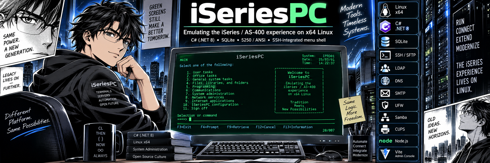

# iSeriesPC

Emulation of the IBM iSeries/AS-400 experience on x64 Intel Linux, implemented in C# (.NET 8)
over SQLite, with host-level integrations for SSH/SFTP, LDAP, DNS, SMTP, UFW, Samba, CUPS,
Node.js and a Vite admin console.

The SSH login shell is replaced by an iSeries-style menu interface (`AS400Menu`) with a full
5250/ANSI full-screen experience: sign-on, menus, CL command line, prompting (F4), help (F1),
function keys, subfiles and paging.

## Status

Under construction. See [PLAN.md](PLAN.md) for the master task list and the tracked
[compatibility matrix](docs/compatibility-matrix.md) for requirement-level status.
The verified original baseline is 223 passing tests; package completion requires
the additional acceptance criteria in the plan.

Latest [completion checkpoint](docs/completion-progress.md): 36/106 checklist items
complete, 2309 tests passing, and real sign-on/display PTY acceptance passing.
The C11 [job data-area storage lifecycle](docs/job-environment.md#c11-storage-completion-evidence)
is verified across submission, routing, group sharing, process concurrency, restart and cleanup.
[QWCRDTAA](docs/data-areas.md#qwcrdtaa-retrieval-api) now retrieves typed named/job
areas through checked binary receivers, compiled CL and borrowed RPG calls.
Durable [user spaces](docs/user-spaces.md) now support binary storage, resizing,
object lifecycle, commands and six native API adapters, including
[job-private QTEMP](docs/temporary-libraries.md), generic deletion with partial-failure
reporting, native EXCLRD writes and live domain policy on copy/move. Further private domain stores and
native compatibility work remain open.
QTEMP source/PF/simple LF storage now supports private members, CL/RPG compilation,
record I/O, shared paths, copy/export and recovery cleanup.
[Private message queues and files](docs/message-queues.md#job-private-queues-and-message-files)
now support saved descriptions, inquiry replies across jobs, isolated storage and atomic cleanup.
[Message subfiles](docs/display-files.md#message-subfiles) now bind to live job/frame
queues, capture text and second-level help at output, and load queues with SFLINZ.
Compiled CL DCLF/SNDF/RCVF/SNDRCVF now exchange typed fields and indicators with
local/socket terminals, including message-subfile help, nested calls, initial
programs and suspended-job transfers. Compiled RPG
[WORKSTN/EXFMT](docs/rpg-spec.md#12-workstn-display-files-and-subfiles) now exchanges
typed forms and ordinary/message subfiles, with READC/CHAIN/UPDATE RRNs and
activation-group file lifetimes. Wider native language, messaging and device work remains open.
Six [native message APIs](docs/api.md#native-message-program-apis) now send,
receive, reply and retrieve through shared queues and saved descriptions, with
binary receivers and cancellable allocated waits. RPG can call them directly using
raw CHAR and signed INT fields. `WRKAPILS` discovers all 27 runtime adapters and
shows their current availability and supported contract.
[QWCRSVAL](docs/system-values.md) retrieves 27 backed system values through native
aligned receivers, including binary policy values and consistent local date/time.
Reads observe committed changes from other hosts.
[QUSRJOBI and QUSLJOB](docs/job-apis.md) now retrieve basic/library information
and produce native user-space job lists with 17 backed fields, raw job IDs and
maximum-space continuation. Compiled CL/direct RPG and independent socket jobs
share the same work catalog while retaining private QTEMP storage.
[QWCCVTDT](docs/date-time-apis.md) converts native calendar/Julian dates and
binary timestamps, with millisecond/microsecond precision and UTC/host-zone
conversion. Job attributes and named time-zone metadata remain open.
[Software cryptography](docs/cryptography-apis.md) now provides native hash/HMAC,
AES encryption/decryption and encrypted job-owned key contexts. Compiled CL and
direct RPG exercise all six QC3 adapters; key ownership, rotation and end-of-job
cleanup use the shared catalog and authorization services.
RPG supports [compilation diagnostics](docs/rpg-spec.md#11-compilation-diagnostics-and-source-coverage),
[bounded preprocessing](docs/source-preprocessing.md#rpg-directives) and
[scalar prototype API calls](docs/api.md#scalar-prototype-calls).

| WP | Component | Status |
|----|-----------|--------|
| WP0 | Foundation | build baseline verified |
| WP1 | Ipc.Core domain model | partial — see compatibility matrix |
| WP2 | Ipc.Services host (SQLite, config, logging, events, IpcSystem) | partial — see compatibility matrix |
| WP3 | Security engine | partial — see compatibility matrix |
| WP4 | Job/work-management engine | partial — see compatibility matrix |
| WP5 | Terminal + display engine (ANSI 5250, fields) | partial — see compatibility matrix |
| WP6 | Session host (as400menu) + sign-on | partial — see compatibility matrix |
| WP7 | Menus system (MAIN/MAJOR, GO, *MENU objects) | partial — see compatibility matrix |
| WP8 | CL command system + interpreter (*CMD catalog, CRTCLPGM, CALL, command line) | partial — see compatibility matrix |
| WP9 | DDS compiler + SQLite file store (*FILE objects, members, record codec, CRTSRCPF/ADDSRCPFM/CRTPF/DSPPFM/ADDPFM/CPYF/DLTF) | partial — see compatibility matrix |
| WP10 | RPG compiler + interpreter (fixed + free form, `/free` directives, data structures, expressions + `%` built-ins, file I/O, subroutines, subprocedures P/D + CALLP, prototypes PR/PARMs + `PROCPTR`, `CALL`/`CALLP` with PLIST + updated-parameter writeback, `ON-ERROR`/`*INLR`, messaging) | partial — see compatibility matrix |
| WP12 | Messaging and data objects (durable MSGQ, typed DTAARA, FIFO/LIFO/keyed DTAQ, byte-addressable USRSPC) | partial — wider messaging/API integration and journals remain open |
| WP15 | System API host (QCMDEXC, checked local data-queue and user-space programs) | partial — broader API registry, formats and crypto remain open |

## Layout

This is the target layout; the compatibility matrix distinguishes implemented and planned components.

- `src/Ipc.Core` — domain model: objects, libraries, authorities, system values, CCSID, dates, *MENU objects
- `src/Ipc.Services` — job engine, spool engine, security, menu store, IFS, save/restore, messaging, journals
- `src/Ipc.Db` — SQLite catalog, DDS compiler, SQL bridge, SQL tools
- `src/Ipc.Cl` — command catalog, parser, prompt, CL program interpreter
- `src/Ipc.Rpg` — RPG interpreter (fixed + free form)
- `src/Ipc.Dsp` — DSPF compiler + panel/subfile runtime
- `src/Ipc.Terminal` — ANSI 5250 renderer + input editor
- `src/Ipc.Console` — `AS400Menu` SSH login-shell host + sign-on
- `src/Ipc.Api` — checked data-queue and user-space program buffers; broader APIs planned
- `src/Ipc.Session` — shared controllers, command orchestration, and terminal session transport
- `src/Ipc.Server` — `as400server` catalog/session owner
- `src/Ipc.Web` — ASP.NET Core REST + IWS-style program services + 5250-over-websocket
- `src/Ipc.WebUi` — Vite SPA admin console
- `src/Ipc.Bridge` — interop/migration CLI
- `src/Ipc.Installer` — provisioning + first-run wizard + systemd

See `docs/*` for architecture, object model, and command/RPG/DDS specifications.

## Build & test

```
dotnet restore iSeriesPC.sln --locked-mode
dotnet build iSeriesPC.sln --no-restore -c Release
dotnet test iSeriesPC.sln --no-build -c Release
```

Build with SDK 8.0.425 (pinned in `global.json`). See [build/runtime policy](docs/build-baseline.md).

## Run the shared terminal host

```sh
dotnet run --project src/Ipc.Server -c Release -- --data-dir /path/to/instance
# In another terminal, under the same OS account:
dotnet run --project src/Ipc.Console -c Release -- --data-dir /path/to/instance
```

`as400menu` connects to the shared server by default. `--server SOCKET` selects an
explicit Unix socket; `--standalone` keeps the embedded development mode. Use
`--migrate-only` for [catalog migration and recovery](docs/catalog-migrations.md).
New catalogs generate a private initial-password file; see [authentication and recovery](docs/authentication.md).
The socket defaults to owner-only, with explicit group access configuration. Real SSH/PAM
integration is tested; multi-account host provisioning and full web/batch feature delivery remain open;
this is not yet a production deployment. See [architecture](docs/architecture.md).
